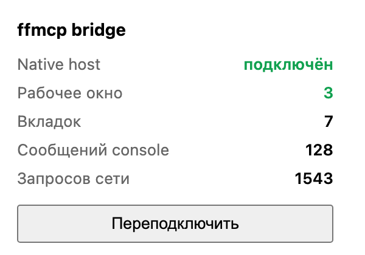
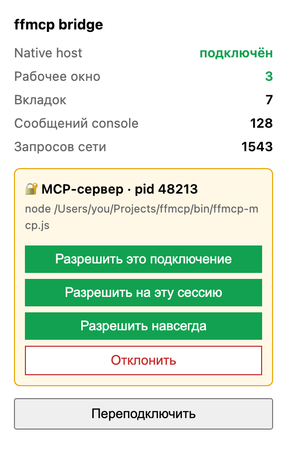

# ffmcp

Расширение Firefox + MCP-сервер, дающие агентам полный доступ к твоему настоящему браузеру.
Транспорт целиком локальный: **stdio и Unix-сокет, ни одного HTTP-запроса и ни одного открытого порта**.

## Как устроено

```
MCP-агент  ──stdio JSON-RPC──▶  ffmcp-mcp.js
                                     │
                                     │  Unix-сокет ~/.ffmcp/ffmcp.sock (права 0600)
                                     ▼
                                ffmcp-host.js          ← запускается самим Firefox
                                     │
                                     │  native messaging (stdio, 4 байта длины + JSON)
                                     ▼
                             расширение ffmcp  ──▶  WebExtension API
```

Native-хост поднимается Firefox'ом при старте расширения и работает как брокер: держит
сокет, к которому подключаются MCP-серверы. Поэтому **несколько агентов одновременно**
работают с одним браузером, а внешне не открыт ни один сетевой порт.

Ответы больше ~700 КБ (скриншоты, дампы DOM) автоматически режутся на чанки и собираются
обратно в хосте — ограничение native messaging на размер сообщения обходится прозрачно.

## Установка

```bash
cd ~/Projects/ffmcp
./install.sh
```

Скрипт кладёт манифест native-хоста в `~/Library/Application Support/Mozilla/NativeMessagingHosts/ffmcp.json`
и создаёт лаунчер с абсолютным путём к `node` (Firefox из Finder не видит `/opt/homebrew/bin`).

Затем ставим расширение:

1. `about:debugging#/runtime/this-firefox`
2. **Загрузить временное дополнение…** → выбрать `extension/manifest.json`
3. Проверить: `./bin/ffmcp.js doctor`

> Временное дополнение живёт до перезапуска Firefox. Чтобы поставить навсегда, нужен
> Firefox Developer Edition / Nightly / ESR с `xpinstall.signatures.required = false`
> в `about:config` — тогда собери `.xpi` (`cd extension && zip -r ../ffmcp.xpi .`) и
> установи через `about:addons` → **Установить дополнение из файла**. В обычном релизном
> Firefox неподписанные расширения навсегда поставить нельзя — это ограничение Mozilla.

## Подключение к агентам

Claude Code:

```bash
claude mcp add firefox -- node ~/Projects/ffmcp/bin/ffmcp-mcp.js
```

Любой другой MCP-клиент (`mcp.json`, Cursor, Zed):

```json
{
  "mcpServers": {
    "firefox": {
      "command": "node",
      "args": ["/абсолютный/путь/к/ffmcp/bin/ffmcp-mcp.js"]
    }
  }
}
```

## Инструменты

35 инструментов. Основные:

| Группа | Инструменты |
|---|---|
| Рабочее окно | `firefox_use_window`, `firefox_new_window` |
| Вкладки и окна | `firefox_tabs`, `firefox_open`, `firefox_navigate`, `firefox_close_tab`, `firefox_activate_tab`, `firefox_reload`, `firefox_back`, `firefox_forward`, `firefox_windows` |
| Страница | `firefox_snapshot`, `firefox_read`, `firefox_html`, `firefox_eval`, `firefox_click`, `firefox_fill`, `firefox_press`, `firefox_wait_for`, `firefox_screenshot` |
| Отладка | `firefox_console`, `firefox_network` |
| Профиль | `firefox_cookies`, `firefox_cookie_set`, `firefox_cookie_remove`, `firefox_history`, `firefox_bookmarks`, `firefox_downloads`, `firefox_storage`, `firefox_containers`, `firefox_recent_closed` |
| Всё остальное | `firefox_api`, `firefox_api_describe` |

**`firefox_api` — это и есть «полный доступ».** Он вызывает любой метод WebExtension API
напрямую, так что агент не ограничен готовым списком:

```json
{ "path": "tabs.query", "args": [{ "audible": true }] }
{ "path": "browsingData.removeCache", "args": [{}] }
{ "path": "proxy.settings.set", "args": [{ "value": { "proxyType": "none" } }] }
```

`firefox_api_describe` показывает, что вообще доступно (`{"path": "cookies"}` → список методов).

### Рабочее окно

По умолчанию операции без явного `tabId` идут в активную вкладку текущего окна — то есть
туда, где сейчас работаешь ты. Чтобы агент не мешал, закрепи за ним окно:

```
firefox_new_window {"url": "https://example.com"}   # своё окно, сразу закреплено
firefox_use_window {"windowId": 3}                  # закрепить существующее
firefox_use_window {}                               # показать текущее закрепление
firefox_use_window {"release": true}                # снять
```

После закрепления в это окно уходят все операции без `tabId`, туда же открываются новые
вкладки, а `firefox_tabs` показывает только его вкладки (`allWindows: true` — все).
В `firefox_windows` закреплённое окно помечено `target: true`, а в попапе расширения видно
строкой «Рабочее окно». Закрепление переживает перезагрузку расширения и снимается само,
если окно закрыть. Из CLI — `ffmcp use-window <id>` и `ffmcp new-window [url]`.



### Работа со страницей

`firefox_snapshot` возвращает интерактивные элементы с короткими `uid` — это дешевле
скриншота и точнее селекторов:

```json
{ "uid": "e12", "tag": "input", "type": "email", "text": "Email address", "rect": {...} }
```

Далее `firefox_fill {uid: "e12", value: "..."}` и `firefox_click {uid: "e15"}`.
`firefox_fill` выставляет значение через нативный сеттер прототипа и шлёт `input`/`change`,
поэтому корректно работает с React, Vue и Svelte.

`firefox_eval` выполняет код в контексте страницы — это тело async-функции, доступны
`await` и `return`:

```js
return [...document.querySelectorAll("h2")].map(h => h.innerText)
```

Логи консоли и необработанные исключения собираются автоматически на каждой загруженной
странице (буфер на 2000 записей), сетевые запросы — через `webRequest`. Читать через
`firefox_console` и `firefox_network`. Вывод `console.*` из самого `firefox_eval` тоже
попадает в буфер, хотя код выполняется в песочнице контент-скрипта.

## CLI

Тот же мост доступен вручную, без агента:

```bash
./bin/ffmcp.js doctor                      # диагностика
./bin/ffmcp.js status                      # версия Firefox, число вкладок
./bin/ffmcp.js tabs                        # список вкладок
./bin/ffmcp.js open https://example.com
./bin/ffmcp.js snapshot 12                 # элементы вкладки 12
./bin/ffmcp.js eval 'return document.title'
./bin/ffmcp.js api tabs.query '[{"pinned":true}]'
./bin/ffmcp.js call page.text '{"tabId":12}'
```

## Тесты

```bash
./tests/run.sh
```

Живой Firefox не нужен — браузер и расширение заменяются заглушками. Проверяются: сборка
JSON-RPC и все схемы инструментов, проход вызова MCP → сокет → хост → расширение, сборка
чанкованных ответов, очистка сокета, отсутствие синхронных циклов при загрузке фоновой
страницы и, отдельно, устойчивость перехватчика консоли к зацикливанию.

Последний тест не декоративный. В первой версии обмен со страницей шёл через
`window.postMessage`, а его видит и сама страница: если её код логирует полученные
сообщения (частый паттерн у виджетов и аналитики), возникала петля
`console.log → postMessage → обработчик страницы → console.log`. Каждая итерация уходила
в фон отдельным `runtime.sendMessage`, забивая главный поток родительского процесса
Firefox, и браузер переставал реагировать на ввод. Сейчас обмен идёт приватным
`CustomEvent` со случайным именем, стоят защита от реентрантности, лимит 100 сообщений
в секунду со страницы, батчинг раз в 250 мс и общий потолок 500 записей в секунду в фоне.

## Безопасность

Это по построению очень мощный доступ: агент видит твои cookies, историю и авторизованные
сессии и может действовать от твоего имени на любом сайте.

### Подтверждение подключения

Каждое новое подключение MCP-клиента к сокету пользователь подтверждает вручную. Пока
не подтверждено — все вызовы (кроме health-check `ping` и `__status`) висят, а хост
показывает нотификацию Firefox. Клик по ней открывает popup расширения, где для запроса
предлагается выбор области:




- **это подключение** — доступ только для текущего живого соединения; переподключился клиент — спросят снова;
- **на эту сессию** — до перезапуска Firefox (запоминается токен клиента в памяти хоста);
- **навсегда** — токен клиента сохраняется в `~/.ffmcp/allowed.json` (0600) и переживает перезапуск.

Клиент идентифицируется стабильным токеном из `~/.ffmcp/client-token` (0600); MCP-сервер
и CLI используют один и тот же токен, поэтому одобрение «навсегда» покрывает оба. Если
пользователь не реагирует за `FFMCP_APPROVAL_TIMEOUT_MS` (по умолчанию 60000 мс), доступ
отклоняется (fail-closed). Полностью выключить гейт — `FFMCP_APPROVAL=0` (для headless/CI).

Ограничение платформы: кнопок в нотификациях Firefox нет, поэтому подтверждать нужно
именно в popup (нотификация только сигналит и открывает его).

- Сокет лежит в `~/.ffmcp` с правами `0600` — доступен только твоему пользователю,
  никакой сети, ни локальной, ни внешней.
- Буферы `firefox_console` и `firefox_network` пишутся постоянно, со всех вкладок, и в них
  оседает то, что страницы логируют сами. На практике это бывают почта, идентификаторы
  аккаунта, тариф и прочие персональные данные — например, `claude.ai` печатает в консоль
  полный набор трейтов аналитики. Любой подключённый агент прочитает это одним вызовом.
  Чистить буфер: `firefox_console {"clear": true}`.
- `allowed_extensions` в манифесте хоста ограничивает подключение расширением `ffmcp@local`.
- Чтобы временно всё отключить — просто выгрузи расширение в `about:debugging`
  или закрой Firefox: сокет исчезает вместе с хостом.
- Лог хоста: `~/.ffmcp/host.log`.

## Диагностика

| Симптом | Причина |
|---|---|
| `сокет не найден` | Firefox не запущен либо расширение не загружено |
| `расширение ffmcp не подключено к хосту` | хост поднялся, но расширение отвалилось — жми «Переподключить» в попапе |
| Значок расширения показывает `off` | native-хост не запускается; смотри `~/.ffmcp/host.log` и проверь путь к `node` в лаунчере |
| `скрипт не вернул результат` | страница закрыта CSP или это внутренняя страница (`about:`, `addons.mozilla.org`) — там расширения работать не могут |
| Вызовы висят, значок показывает `!` | ждёт твоего подтверждения — открой popup ffmcp и выбери область доступа |
| `доступ к Firefox не подтверждён (таймаут)` | никто не нажал подтверждение за отведённое время; повтори вызов и подтверди в popup |
| Агент переспрашивает доступ каждый раз | одобрено «на подключение»; выбери «на сессию» или «навсегда» |
